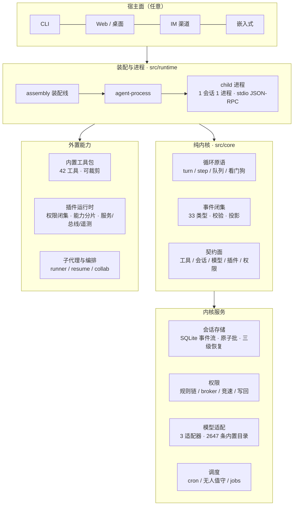

# {{NAME}}

> **本地优先的多端 AI Agent 内核** —— 最小语义面 · 装配全外置 · 万物可插件
>
> A local-first, multi-surface AI agent kernel. Minimal semantic core,
> fully externalized assembly, everything pluggable.

[](LICENSE)
[](package.json)
[](#治理与质量)
[](#治理与质量)

---

## 为什么是 {{NAME}}

绝大多数 Agent 框架把"内核"和"产品"焊死在一起：换一个 UI、换一种部署形态、
换一类模型供应商，都要动内核。{{NAME}} 从第一行代码起就拒绝这个前提——

**内核只回答一个问题：一次 Agent 回合如何正确地开始、推进、落盘、结束。**
其余的一切（界面、渠道、工具集、模型、权限策略、记忆、调度）都是**装配**。

- **零宿主假设**：内核不认识 CLI、Web、IM、桌面或嵌入式——宿主以装配数据接入，
  内核与宿主之间只有契约，没有 import。
- **事件源唯一真相**：一次会话就是一条 append-only 事件流。投影可从流重建，
  崩溃可从流恢复，审计可从流复现——不存在"第二份状态"。
- **权限是内核契约，不是扩展自觉**：四层规则链、审批 broker、审批竞速、
  规则写回全在内核层，任何宿主、任何插件都绕不过。
- **装配即数据**：工具、插件、模型、技能、提示词段全部声明式注册，
  可裁剪、可热重载、可能力上限冻结。

## 架构



## 核心能力

| 层 | 能力 |
|---|---|
| **内核** | 33 类事件闭集（JSON 安全 + 穷尽断言 + 投影校验）· turn/step 循环 · 提示队列三节奏 · 看门狗 · 流恢复 · 变异预算 |
| **会话** | SQLite 事件流 · write-behind 串行落库 · commit 原子批（事件+标题+血统+文档同事务）· 三类恢复降级（strict/lenient/discard）· fork / revert / checkpoint · 前向兼容信封（ignorable 跳痕） |
| **权限** | 四层规则链（不可跳层）· 危险命令/路径/网络语义匹配 · broker 单出口 · **审批竞速**（先到者胜，慢 hook 不阻塞用户）· scope=always 规则写回 · 计划模式进出权限 · 配置行级写回（保注释/原子/TOCTOU 防线） |
| **模型** | anthropic-messages / google-generate / openai-compat 三适配器 · **2647 条内置模型目录**（数据化生成，用户配置优先兜底）· 换模型压缩阈值跟随 · 重试 / 故障容忍 / 健康探测 / 缓存健康 / OAuth |
| **工具** | 42 个可注册内置工具（16 常驻 + 26 条件）· 描述外置（改文案零代码 diff）· spill 配额 · 后台 shell · read-gate 记账 · win32 受限令牌沙箱 · 工具负载差量声明 |
| **编排** | 子代理 runner（深度/并发上限 · resume · task_send 定向投递 · steer）· 跨会话协作（七动作 · 环检测 DAG · 4/16 在途上限 · 回投幂等）· cron 无人值守（冷恢复 · 只补最近一次） |
| **插件** | manifest + 17 权限闭集 + 8 能力分片 · 贡献↔权限绑定校验 · 热重载能力变宽即拒 · 常驻服务 broker（重启退避）· 声明式总线 · OTel 遥测三实现 · inprocess / ws 双传输 |

## 快速开始

```bash
npm install        # 硬依赖仅 better-sqlite3（内存后端可零 native 运行）
npm test           # 223 文件 / 1988 用例
npm run check      # tsc 严格模式类型检查
npm run architecture:check   # 架构治理（域白名单 · 深导入禁令 · 行数纪律）
npm run kernel:edges         # 内核边检查（core 零出边 · 单一入口）
```

最小装配（零外部服务）：

```ts
import { SessionEventStore, InMemoryEventStorage } from "./src/session/store.js";

const store = new SessionEventStore(new InMemoryEventStorage());
store.append("s1", [{ type: "turn/start", turn: 1 }]);
const events = store.load("s1"); // 事件流即真相
```

接入模型（装配数据，非改内核）：

```ts
// settings.providers 声明供应商与模型；内置目录自动兜底元数据
// { "providers": [{ "name": "main", "adapter": "anthropic",
//     "models": [{ "id": "claude-sonnet-4-5" }] }] }
// contextWindow / 思考档 / 能力位由内置目录补齐——用户显式值永远优先
```

## 目录结构

```
src/core/          纯内核：骨架（事件/循环/队列/看门狗/协议帧）+ 契约面 + 原语
src/runtime/       装配与进程：assembly / agent-process / child 入口
src/ext-builtin/   能力外置：plugin-runtime / prompt-defaults / subagent-engine
src/session/       事件存储与投影：store / db / migrate / collaboration / fork
src/policy/        权限：规则链 / gate / broker / 审批竞速 / 规则与配置写回
src/models/        模型适配 + 内置目录（catalog-data → catalog.generated 数据化生成）
src/scheduler/     调度：cron / offpeak / jobs / 浏览器面板
src/diagnostics/   诊断：遥测 sinks / 成本
plugins/tools-builtin/   内置工具包（42 工具，可裁剪注册）
tools/             治理工具：架构检查 / 词汇检查 / 内核边 / 目录生成器
```

## 治理与质量

| 指标 | 当前 |
|---|---|
| 测试 | **223 文件 / 1988 用例**（vitest，含进程级 e2e） |
| 类型 | TypeScript 严格模式 + `noUncheckedIndexedAccess`，0 error |
| 架构 | 16 域白名单 + requires 声明 + 深导入禁令，**0 error** |
| 内核边 | `src/core` 零出边 + 单一公开入口（barrel），机器校验 |
| 依赖 | 硬依赖 1 个（`better-sqlite3`）+ 3 个可选面，零传递依赖膨胀 |

架构决策、技术债台账与依赖环收紧路线记录于主仓
[内核排查报告](https://github.com/Aegink/aegent/blob/main/docs/20261011_内核重构W16全面排查报告.md)。

## 与 aegent 的关系

{{NAME}} 是从 [aegent](https://github.com/Aegink/aegent) 平台抽取的**内核层**，
以 Apache-2.0 独立发布（主仓整体为 AGPL-3.0；本仓由版权所有者 Aegink 授权
以宽松许可单独发布）。产品形态（CLI / Web / 桌面 / IM / 无人值守）留在主仓；
本仓只含内核与可插拔能力面，可被任何产品形态复用。

## 免责声明

**请在使用前完整阅读 [DISCLAIMER.md](DISCLAIMER.md)。** 摘要如下：

- 本软件按 **"原样"（AS IS）** 提供，**不附带任何明示或默示的担保**，
  包括但不限于适销性、特定用途适用性与不侵权担保。
- 本软件是 **AI Agent 执行框架**：模型可能自主发起**文件写入、命令执行、
  网络访问**等具有真实副作用的操作。**由此产生的一切后果（数据丢失、
  系统损坏、费用支出、合规责任）由使用者自行承担**，作者与贡献者不承担
  任何责任。
- 使用者须自行确保使用场景**合法合规**，并自行负责**凭据安全、
  数据备份、权限最小化与人工复核机制**的建立。
- 模型输出内容（含代码、建议、判断）**不构成任何专业意见**，
  不应用于法律、医疗、金融等高风险决策场景。

## 致谢

{{NAME}} 的设计得益于开源社区的先驱工作。完整清单见
[ACKNOWLEDGMENTS.md](ACKNOWLEDGMENTS.md)，第三方组件登记见
[THIRD_PARTY.md](THIRD_PARTY.md)。谨向以下项目的作者与维护者致谢：

**设计借鉴（行为研究，零代码复制）**：
[pi](https://github.com/earendil-works/pi)（agent 循环 / 提示队列 / 模型目录 /
工具差量声明 / 输出截断纪律）、
[PI-Desktop](https://github.com/vastsa/PI-Desktop)（编排方向盘 / 子代理 /
审批竞速）、
[opencode](https://github.com/anomalyco/opencode)（runTask 单轮语义）、
[deepseek-harness](https://github.com/deepseek-ai/deepseek-harness)（事件词汇 /
工具配平 / continuable 回投）、
[ZCode](https://github.com/zai-org/ZCode)（审批竞速 / 配置热刷 / 输出续跑）、
[kimi-code](https://github.com/MoonshotAI/kimi-code)（行级写回 / turn 结算）、
[codex](https://github.com/openai/codex)（工具保留声明 / 沙箱分级）、
[hermes-agent](https://github.com/NousResearch/hermes-agent)（模型目录三纪律）、
[agentscope](https://github.com/modelscope/agentscope)（权限档位归一）、
[qwen-code](https://github.com/QwenLM/qwen-code)、
[grok-build](https://github.com/xai-org/grok-build)、
[mini-swe-agent](https://github.com/SWE-agent/mini-swe-agent)、
[Mini-Agent](https://github.com/MiniMax-AI/Mini-Agent)、
[pi-mono](https://github.com/lue-labs/pi-mono)、
[PiDeck](https://github.com/ayuayue/PiDeck)。

**运行时依赖**：[better-sqlite3](https://github.com/WiseLibs/better-sqlite3)、
[ws](https://github.com/websockets/ws)、
[undici](https://github.com/nodejs/undici)、
[fetch-socks](https://github.com/Kusabi/fetch-socks)。

**特别致谢**：[Claude Code](https://github.com/anthropics/claude-code) 团队——
其公开产品行为与文档为权限模型、工具契约与 Agent 交互范式提供了重要参考
（仅研究公开行为，未使用任何专有代码）。

## 许可

[Apache License 2.0](LICENSE) · 版权声明与第三方登记见 [NOTICE](NOTICE)。

```
Copyright 2026 Aegink

Licensed under the Apache License, Version 2.0 (the "License");
you may not use this file except in compliance with the License.
You may obtain a copy of the License at

    http://www.apache.org/licenses/LICENSE-2.0
```
